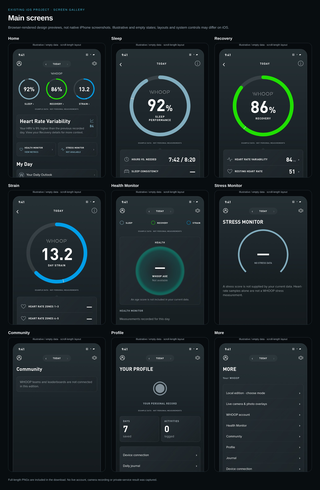
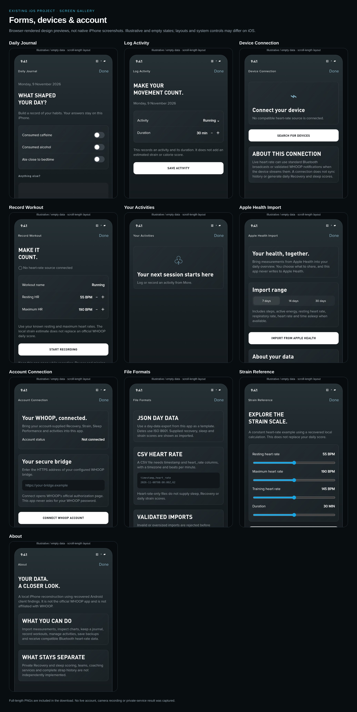
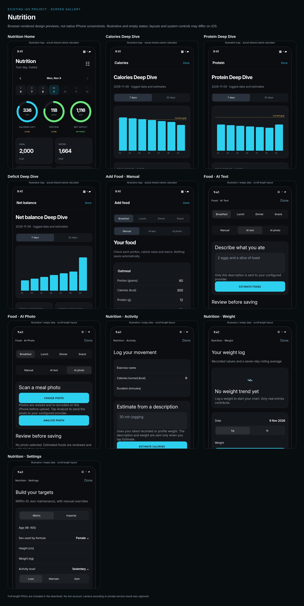
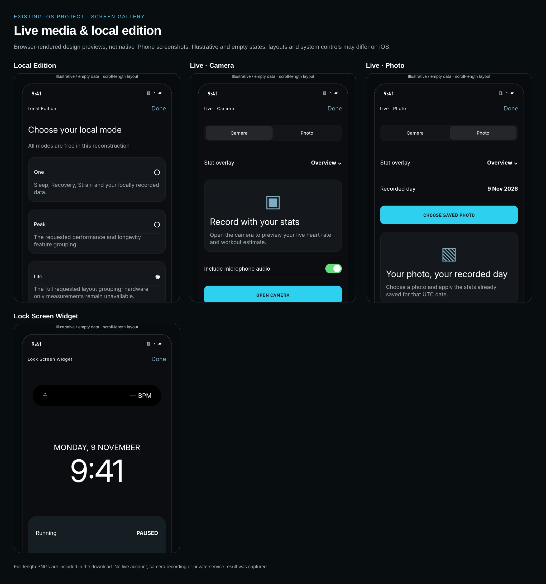

# App photos available now

[Download every available image (ZIP)](App-screen-photos.zip)

## Current native iPhone screenshots

Four actual iPhone simulator screenshots from the current app: Home and first launch, each in English and Arabic. Sample data is used.

 | English | العربية |
 | --- | --- |
 | [First launch](native/01-first-launch-en.png) | [First launch](native/01-first-launch-ar.png) |
 | [Home](native/02-home-en.png) | [Home](native/02-home-ar.png) |

## Earlier design previews — 33 screens

These are older browser-rendered design approximations from November 9. They are **not current native iPhone screenshots** and do not include the latest Arabic and Liquid Glass changes. They cover the earlier main screens, Nutrition, Live, settings, tracker, activity and account forms.

[Open the earlier preview image folder](earlier-design-previews)

## Full current native capture

The 80-view English + Arabic capture is queued on GitHub Mac runners. The photos above remain separate from that pending capture.

[Intel capture job](https://github.com/abdullahalmaeeni7-dot/noop-custom1/actions/runs/43917107064) · [macOS 26 capture job](https://github.com/abdullahalmaeeni7-dot/noop-custom1/actions/runs/43917242848)

Download the ZIP, extract it, and open **index.html** to browse all available images.

### Earlier main screen previews

### Earlier forms and account previews

### Earlier Nutrition previews

### Earlier Live previews

