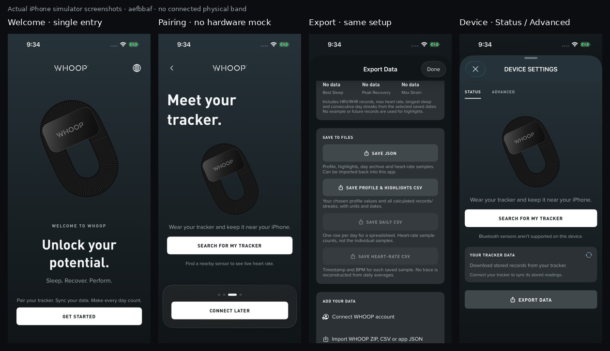
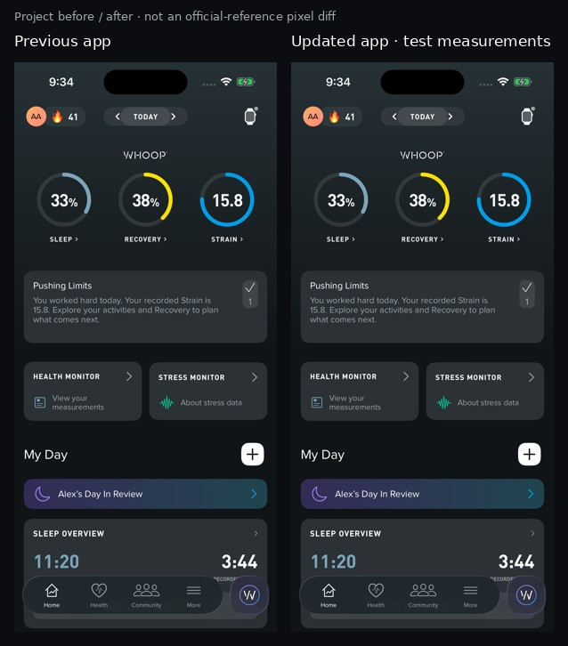

# Setup, tracker and Home — native review

Source: `aefbbaf7d21f05f6247c854d68c2ffe6e399408b`. [Native simulator run](https://github.com/abdullahalmaeeni7-dot/noop-custom1/actions/runs/45193379479). Capture outcome: **success**. Two real XCUITest interaction tests passed with zero failures in 77.835 seconds. The long workflow duration includes native compilation and simulator capture; this is not an app-startup timing measurement.

The gallery is composed of actual screenshots, resized only for this contact sheet. Setup screenshots contain no simulated band or sensor readings. The simulator correctly reports Bluetooth hardware unavailable. All eleven original PNGs are available in the immutable [capture branch](https://github.com/abdullahalmaeeni7-dot/noop-custom1/tree/visual-review/45193379479).

| Screen | Original screenshot |
| --- | --- |
| Welcome — one Get Started button | [Open](https://github.com/abdullahalmaeeni7-dot/noop-custom1/raw/refs/heads/visual-review/45193379479/flow-01.png) |
| Tracker pairing | [Open](https://github.com/abdullahalmaeeni7-dot/noop-custom1/raw/refs/heads/visual-review/45193379479/flow-02.png) |
| Sync and import, before scrolling to export | [Open](https://github.com/abdullahalmaeeni7-dot/noop-custom1/raw/refs/heads/visual-review/45193379479/flow-03.png) |
| Export during the same setup | [Open](https://github.com/abdullahalmaeeni7-dot/noop-custom1/raw/refs/heads/visual-review/45193379479/flow-04.png) |
| Personal Home, without imported or sample scores | [Open](https://github.com/abdullahalmaeeni7-dot/noop-custom1/raw/refs/heads/visual-review/45193379479/flow-05.png) |
| Simple Device Status | [Open](https://github.com/abdullahalmaeeni7-dot/noop-custom1/raw/refs/heads/visual-review/45193379479/flow-06.png) |
| Arabic welcome | [Open](https://github.com/abdullahalmaeeni7-dot/noop-custom1/raw/refs/heads/visual-review/45193379479/flow-07.png) |
| Settled Home rings — isolated test data | [English](02-home-en.png) · [Arabic](https://github.com/abdullahalmaeeni7-dot/noop-custom1/raw/refs/heads/visual-review/45193379479/02-home-ar.png) |
| Fresh first launch, independent of UI tests | [English](https://github.com/abdullahalmaeeni7-dot/noop-custom1/raw/refs/heads/visual-review/45193379479/01-first-launch-en.png) · [Arabic](https://github.com/abdullahalmaeeni7-dot/noop-custom1/raw/refs/heads/visual-review/45193379479/01-first-launch-ar.png) |

## Verified behavior

- The old separate tracker/data welcome branches are absent. Get Started proceeds through profile, tracker, sync/import/export and Home.
- A saved profile and the pairing step survive app termination/relaunch. Completing setup opens the personal Home screen.
- The data step opens measurement export after pairing/search, without choosing a different welcome path. Profile-only JSON export is enabled. The native Files save itself was not exercised by these UI tests; export encoders and round trips are covered by the portable suite.
- Status opens with pairing, saved readings/sync and export. Diagnostics and local estimates remain under Advanced, which the test opens separately.
- A simulator without a tracker never shows Receiving Data. Unit tests separately cover freshness expiry, invalid/future readings and Bluetooth-link-only states.
- Arabic welcome has the same single entry. Eleven PNGs, test attachment metadata and success diagnostics were retained.

## Home comparison and remaining differences

This compares the previous project build with this build, **not** the official app. The fixture's 33% Sleep, 38% Recovery and 15.8 Strain exist only in the disposable simulator; first launch never seeds them into production. The Home geometry remains 81-point rings with 5.8-point rounded strokes. Home and detail now share one renderer, whose stroke stays inside its declared diameter and whose empty arc is invisible. Detail fill and numeric changes animate with Reduce Motion support.

The visible differences identified in [the previous review](../native-review-06/REVIEW.md) still apply: system tracker/monitor icons, unavailable real battery/status readings, alternative measured-data explanations, sleep recommendations and alarm integration, hardware status-bar geometry, and content wrapping. Welcome and the vector band illustration are app-specific. Original reference image bytes and official animation recordings are absent, so exact pixel equality and original animation timing are not established. These changes do not constitute complete WHOOP app or service parity.

## Device build

The [iPhone build](https://github.com/abdullahalmaeeni7-dot/noop-custom1/actions/runs/45193379535) passed. The [unsigned IPA](https://github.com/abdullahalmaeeni7-dot/noop-custom1/raw/refs/heads/device-download/aefbbaf7d21f05f6247c854d68c2ffe6e399408b/WHOOP-unsigned.ipa) is 4,603,025 bytes; SHA-256 `0185a67ef57d50edf124c5feb89a598d5a3f9c731433ae1dde8eafc66b4ac94c`. Downloaded checksum, arm64 iPhone platform, WorkoutLive extension, new flow/status code markers and launch image configuration were independently checked. Signing/installing on a physical phone, actual band communication, firmware compatibility and full-day background recording remain unverified.
