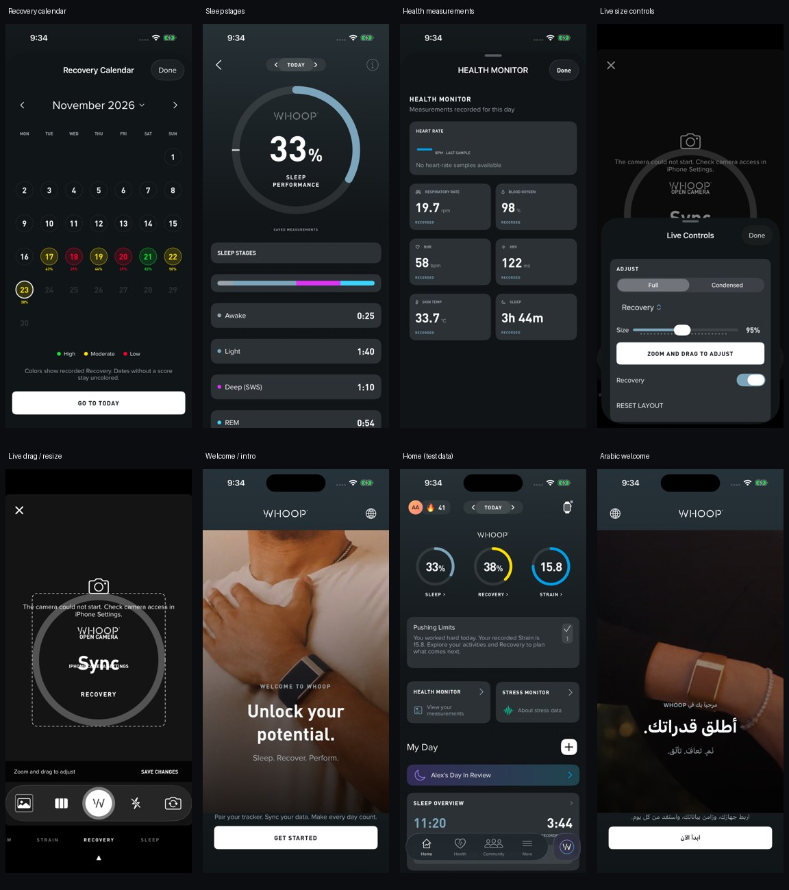

# iPhone simulator review

The SwiftUI app at `f55d7e8` ran on an iPhone 15 Pro simulator. Three setup and Live tests and one calendar, sleep and health test passed. The runner saved 16 screenshots. [Workflow](https://github.com/abdullahalmaeeni7-dot/noop-custom1/actions/runs/45209840359) · [Run result](run.json) · [Setup and Live captures](setup-attachments.json) · [Health and calendar captures](reference-attachments.json).

## What the captures show

- The calendar shows red 29%, yellow 38% and green 82% days. Dates without a Recovery score have a neutral outline or appear dimmed when in the future. Today has a separate selection outline.
- The sleep capture shows 25 minutes awake, 1 hour 40 minutes light, 1 hour 10 minutes deep and 54 minutes REM. Health Monitor shows the imported 98% SpO₂ and 33.7 °C skin temperature. These measurements were seeded only in the disposable simulator.
- The Live controls show an independent Recovery size slider and the on-camera editor shows a drag target. The simulator had no camera feed or paired band. The camera-unavailable instructions overlap the Recovery ring in this build's edit-mode capture. The Live test used an unseeded day, so the ring shows “Sync”. Camera recording, actual band data and export appearance on an iPhone still require a device check.
- Home with the test data shows 33% Sleep, 38% Recovery and 15.8 Strain. The English Home PNG is byte-identical to the previous review's English Home capture. No membership-expiry banner appears. Monitor tiles use recorded-data prompts where the supplied reference shows measured health and stress statuses.
- The English and Arabic welcome captures contain frames from the bundled intro. Still captures verify the visual state of one frame each. Playback timing on a physical iPhone and pixel equality with the official iOS app remain unverified. The [motion manifest](../../../App/Resources/apk-motion-provenance.json) records the source asset dimensions, frame timing and conversion.

## All original captures

The links open the full-size original PNGs from capture commit `59b74d1`. The gallery above uses resized copies.

| Screen | Original |
| --- | --- |
| First launch, English | [1179 × 2556 PNG](https://raw.githubusercontent.com/abdullahalmaeeni7-dot/noop-custom1/59b74d1438250828be2f5ed3c37112d3752448b7/01-first-launch-en.png) |
| First launch, Arabic | [1179 × 2556 PNG](https://raw.githubusercontent.com/abdullahalmaeeni7-dot/noop-custom1/59b74d1438250828be2f5ed3c37112d3752448b7/01-first-launch-ar.png) |
| Home, English, with sample history | [1179 × 2556 PNG](https://raw.githubusercontent.com/abdullahalmaeeni7-dot/noop-custom1/59b74d1438250828be2f5ed3c37112d3752448b7/02-home-en.png) |
| Home, Arabic, with sample history | [1179 × 2556 PNG](https://raw.githubusercontent.com/abdullahalmaeeni7-dot/noop-custom1/59b74d1438250828be2f5ed3c37112d3752448b7/02-home-ar.png) |
| Welcome during setup | [1178 × 2556 PNG](https://raw.githubusercontent.com/abdullahalmaeeni7-dot/noop-custom1/59b74d1438250828be2f5ed3c37112d3752448b7/flow-01.png) |
| Tracker pairing | [1178 × 2556 PNG](https://raw.githubusercontent.com/abdullahalmaeeni7-dot/noop-custom1/59b74d1438250828be2f5ed3c37112d3752448b7/flow-02.png) |
| Sync and import | [1178 × 2556 PNG](https://raw.githubusercontent.com/abdullahalmaeeni7-dot/noop-custom1/59b74d1438250828be2f5ed3c37112d3752448b7/flow-03.png) |
| Export | [1178 × 2556 PNG](https://raw.githubusercontent.com/abdullahalmaeeni7-dot/noop-custom1/59b74d1438250828be2f5ed3c37112d3752448b7/flow-04.png) |
| Personal Home before import | [1178 × 2556 PNG](https://raw.githubusercontent.com/abdullahalmaeeni7-dot/noop-custom1/59b74d1438250828be2f5ed3c37112d3752448b7/flow-05.png) |
| Device status | [1178 × 2556 PNG](https://raw.githubusercontent.com/abdullahalmaeeni7-dot/noop-custom1/59b74d1438250828be2f5ed3c37112d3752448b7/flow-06.png) |
| Arabic welcome during setup | [1178 × 2556 PNG](https://raw.githubusercontent.com/abdullahalmaeeni7-dot/noop-custom1/59b74d1438250828be2f5ed3c37112d3752448b7/flow-07.png) |
| Recovery calendar | [1178 × 2556 PNG](https://raw.githubusercontent.com/abdullahalmaeeni7-dot/noop-custom1/59b74d1438250828be2f5ed3c37112d3752448b7/flow-08.png) |
| Sleep stages | [1178 × 2556 PNG](https://raw.githubusercontent.com/abdullahalmaeeni7-dot/noop-custom1/59b74d1438250828be2f5ed3c37112d3752448b7/flow-09.png) |
| Health Monitor | [1178 × 2556 PNG](https://raw.githubusercontent.com/abdullahalmaeeni7-dot/noop-custom1/59b74d1438250828be2f5ed3c37112d3752448b7/flow-10.png) |
| Live size controls | [1178 × 2556 PNG](https://raw.githubusercontent.com/abdullahalmaeeni7-dot/noop-custom1/59b74d1438250828be2f5ed3c37112d3752448b7/flow-11.png) |
| Recovery overlay in edit mode | [1178 × 2556 PNG](https://raw.githubusercontent.com/abdullahalmaeeni7-dot/noop-custom1/59b74d1438250828be2f5ed3c37112d3752448b7/flow-12.png) |
